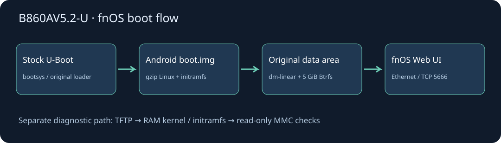

# 中兴 B860AV5.2-U 运行飞牛 fnOS

把一台 **1 GB 内存、8 GB eMMC 的 B860AV5.2-U**，从已 root 安卓适配到内置存储运行 fnOS。本项目记录实际失败、调整、验证和恢复路径，不是通用刷机教程，也不是飞牛官方支持机型。


**2026-11-12 实机结果：** Linux `6.18.18-trim`、fnOS `V1.1.31` 从内置 eMMC 启动；网页进入管理员账户创建页面。只读 Btrfs scrub 检查约 **2.43 GiB** 已用数据，4 分 10 秒完成，零错误。账户与服务条款由设备主人自行设置，验证过程没有替用户创建账户。

| 项目 | 状态 |
|---|---|
| 原厂引导 + Android boot.img 格式 | 实机启动通过 |
| 内置 eMMC 系统盘 | 实机启动、完整已用数据校验通过 |
| 百兆有线网络 / 网页初始化 | 实机通过 |
| 独立 TFTP 网络引导诊断 | 实机通过，见独立目录与 Release |
| HDMI 图形、Wi-Fi、音频 | 未适配，电视黑屏不能单独判断失败 |
| SSD 硬盘盒 | 安卓与原厂 U-Boot 阶段枚举失败，未宣称已解决 |
| v2.1 稀疏线刷包 | 本地结构与文件系统验证通过，**未再次实机烧录** |
| 长期稳定性 / 全部 NAS 功能 | 尚未全面验收 |

## 阅读入口

- [踩坑日志：从 U 盘到网络引导，再到 eMMC](docs/PITFALLS.md)
- [技术适配与分区布局](docs/ADAPTATION.md)
- [线刷包下载、还原、启动](docs/FLASHING.md)
- [网络引导独立入口](network-boot/README.md)
- [格式与打包工具](tools/README.md)
- [来源及二进制授权边界](NOTICE.md)



## 下载：按用途分开

原线刷包含主机私钥及设备配置，仅存于本人 [私有固件备份](https://github.com/liyongliao/b860av52u-fnos-firmware-private/releases)。公开网络引导包通过 [Releases](https://github.com/liyongliao/b860av52u-fnos/releases) 提供，不进入 Git 历史。

| 发布 | 用途 | 验证边界 |
|---|---|---|
| 私有备份 `emmc-v1-verified` | 原始线刷包备份 | 实机曾在 83% 校验超时，但随后成功启动并通过 scrub |
| 私有备份 `emmc-v2.1-sparse` | 精简传输的备用线刷包 | 沿用成功的 boot/DTB/bootloader，RAW/FILL0 稀疏化；仅本地验证 |
| `netboot-diagnostic-v1` | 独立网络引导包 | RAM 中诊断与 eMMC 只读检查，不是完整无盘 NAS 系统 |

当前已经运行的盒子 **无需为了换包重复烧录**。首次启动应预留约 15 分钟，持续通电观察网络。HDMI 本版未启用。成功后访问 `http://盒子IP:5666/`。

## 目录

```text
device-tree/   主线树、厂商元数据、适配差异及混合树生成器
tools/         Amlogic v2 容器、Android sparse、boot.img 构建与还原工具
network-boot/  独立 TFTP 服务、启动命令、只读诊断 init；二进制在独立 Release
docs/          图文介绍、线刷步骤、技术解释、踩坑日志
evidence/      脱敏日志、格式检查结果、实机校验记录
```

## 使用边界

仅验证了本次 `gxlx3_az201_1g` 板、`05S000` eMMC、15,335,424 个 512 字节扇区。名称相似的盒子不能视为同一硬件。芯片以本机信息为准，用户起初判断为 S905L3SB；不将厂商营销名称当作芯片鉴定。

保留原厂分区布局，根系统放原 data 区，禁用通用自动扩分区。不要对本适配版直接运行通用安装、重分区和内核更新脚本。建立数据存储池时不要格式化系统所在 eMMC。

通用命令使用示例 IP；诊断 init 与二进制保留原实测地址，可使用 configure.py 修改。私有线刷 Release 保留本人的实机配置。二进制来源、私有设备备份和公开分发的区别见 [NOTICE](NOTICE.md)。
