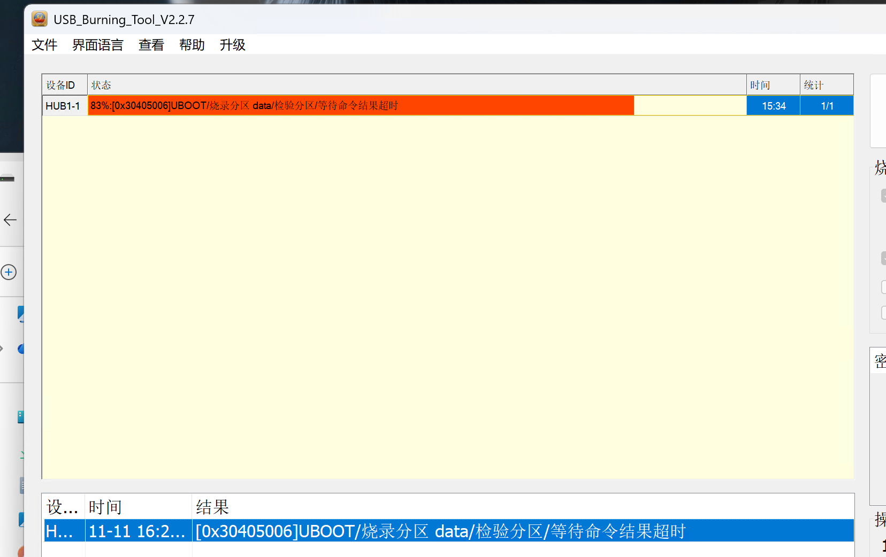

# 踩坑日志

这是一条试验记录，不把每次“有网络”写成“整个系统可用”。时间主要为 2026-11-11 至 12 日，跨午夜；设备时钟曾被校正，所以优先采用试验编号、启动时长和日志事实。

## 1. 不能只凭商品名选择镜像

用户的 B860AV5.2-U 已 root，起初判断芯片为 S905L3SB。通过安卓型号、平台、运行设备树与原厂线刷包，确认本次板级标识 `gxlx3_az201_1g`，1 GB 内存，05S000 eMMC。上游 s905l3b 镜像提供起点，不能代表设备树直接兼容。

## 2. 安卓恢复菜单不是 Linux 已启动

最初 U 盘引导多次进入恢复菜单或返回安卓。不能把 `reboot update` 当成所有晶晨盒子的通用 USB 启动。原厂命令、可用文件系统命令和多启动机制存在差别。后续改用原厂确实支持的读盘命令与 TFTP，并在 U-Boot 环境记录阶段。

早期一次试验出现反复重启，拔盘后仍存在，最终由用户用原安卓包重新线刷恢复。这是真实失败案例；当前流程不能声称从未改动启动状态或没有变砖风险。

## 3. root 安卓不等于现代 ADB 协议兼容

现代 ADB 曾显示 offline，且每次重启后网络调试可能关闭。采用旧协议连接并核验准确型号，避免连错其他电视。只重试端口，不据此判断引导阶段。最终发布的网络引导流程采用明确的一次性计划，不在导入模块时自动连接或重启。

## 4. 内核、设备树和网卡要分别验证

先后精简 SCPI、GPU、VPU、HDMI、热管理等节点，才能进入可诊断的 Linux 阶段。显示关闭是当前适配边界，不是 Linux 必然没启动。

原 PHY 驱动/识别与主线配置不匹配。最后使用通用 DWMAC、100M 全双工 fixed-link，关闭错误 MDIO 路径并保留已由原厂初始化的配置。有了 ping 与 SSH 才能继续看根系统；ping 成功本身不代表飞牛可用。

曾读取安卓厂商网卡调试寄存器接口触发自动重启，后续不再调用该接口。不要把厂商私有 sysfs 节点当成安全的普通信息文件。

## 5. 旧 U 盘能挂根，不等于适合跑 NAS

trial13 已启动完整 Linux/Btrfs/SSH，但网页长期不出现。I/O 压力与 `usb_sg_wait`、`blk_mq_get_tag` 等等待显著。数据库、nginx、Docker 都被拖慢。切换调度器、暂缓部分服务不能充分证明解决了问题，因此转向更快介质。

SSD 硬盘盒在 Windows/Mac 能读，但盒子安卓出现 USB `-71/-110` 枚举错误；原厂 U-Boot 也没完成识别。电脑能读不能证明此盒子的 USB 供电、线材和控制器兼容。没有把这个问题误写为分区格式错误，也没有宣称修好了 SSD。

## 6. 网络引导绕开 USB 介质

原厂 U-Boot 支持 `tftpboot`，不依赖 USB 文件系统。Mac 无法直接使用受限端口时通过 Docker 映射 UDP 69。服务只提供固定文件，逐个 ACK，支持 blksize/tsize；不能把服务器回包源端口的 NAT 问题忽略掉。

网络诊断 init 曾忘记先创建 `/proc`、`/sys`，造成检查内容为空；空文件的 SHA256 不是 eMMC 读取成功证据。修正后才接受两次 4 MiB 读出且哈希一致的结果。

诊断中的 BusyBox wget POST 在本机发生段错误，不能依赖 POST 缺失来判断内核未启动。实际通过临时 HTTP 8088 拉取日志。网络包的诊断脚本仍标记该已知限制。

## 7. eMMC 的高速模式不稳定

主线 HS200 调谐失败时没有枚举到系统盘。移除 DDR、HS200、cap-mmc-highspeed，限制 max-frequency=20 MHz，实测实际时钟约 12 MHz。Linux 识别 7.31 GiB eMMC，两次 4 MiB 读校验一致。低速可用不代表高速已适配。

## 8. 原厂分区不是普通 GPT/MBR

主线出现整个 mmcblk2，但没有自动生成原厂各逻辑分区。保留原布局，用 dm-linear 将原 data 区映射为 fnos-root，而不是贸然重写分区表。根文件系统缩至 5 GiB 并验证能放下。

第一次 dmsetup 已建立映射表，却没有 `/dev/mapper` 设备节点；补 `dmsetup mknodes` 后才完成读出。BusyBox blkid 也不支持完整 util-linux 的 `-s/-o` 参数，改为检查实际输出。

## 9. 不能只把 DTB 放进 Android boot.img 的 second

原 bootloader 早期从 dtbpart 预载树，bootm 优先使用该树。只替换 second 可能仍启动错误树。另外 `rsvmem check` 依赖固定节点路径；需要把主线硬件配置和厂商分区、安全保留、显示元数据合成混合树。

USB 烧录 `save_setting` 路径可能恢复默认环境，不能依赖烧录 env 后启动项仍保留。最后沿用默认 bootsys 和原 bootloader，采用 Android boot.img 形式；压缩 43 MB 内核后原 v1 boot.img 约 18.8 MB，能放进 32 MiB boot 区。trial19 在原厂加载地址 0x01080000 验证了解压与搬移。

## 10. 83% 不是“加载卡住”，后来明确是校验超时

用户先看到 83% 加载 data，约 10 分钟后报：`0x30405006 UBOOT/烧录分区 data/检验分区/等待命令结果超时`。不能把超时说成 SHA1 不一致，也不能据此确认所有数据正确。

停止烧录后正常启动，实机进入内置飞牛。随后只读 scrub 覆盖约 2.43 GiB 已用数据，零错误，这才形成额外完整性证据。

备用包把 5 GiB RAW data 改成 RAW/FILL0 sparse，镜像缩到约 3.48 GiB，减少传输与校验读取量。**保留 VERIFY**，不通过关闭校验隐藏问题。Sparse 校验按原始 sparse 字节 SHA1；FILL 仅检查每段首 4 字节，不能称为全段物理零值检查。FILL0 依赖原厂普通擦除行为。新包不能保证消除所有超时原因，也还没有再次实机烧录。

## 11. 连接突然慢，不代表立即该断电

内置系统初启时 I/O 等待明显，新 SSH 连接也会卡住。曾尝试保留诊断连接，并准备提前调参、RAM 诊断方案；**未成功执行的调参不能归功为最终修复**。未部署的 v3 方案不在发行资产里。

实机持续通电后初始化完成、负载下降、nginx 正常；实际仍使用 bfq、discard=async 和通常网络 offload，Docker 运行。不要编造“关闭 discard 后已解决”。首次启动预留约 15 分钟，优先看网络与日志。

## 12. 结项与仍未解决的事

实机网页版本 V1.1.31，账户创建表单可打开；HDMI、Wi-Fi、音频与 SSD 枚举没有被这次验收顺带解决。检查后删除临时客户端公钥授权；日志与源码不上传客户端私钥。网络引导仅做 RAM 诊断，不能描述成完整持久化无盘 fnOS。
